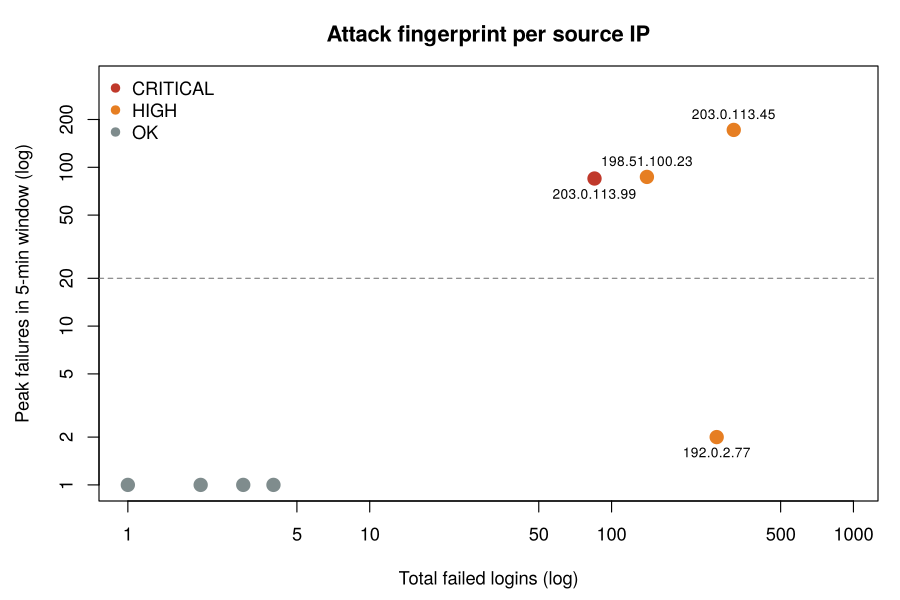
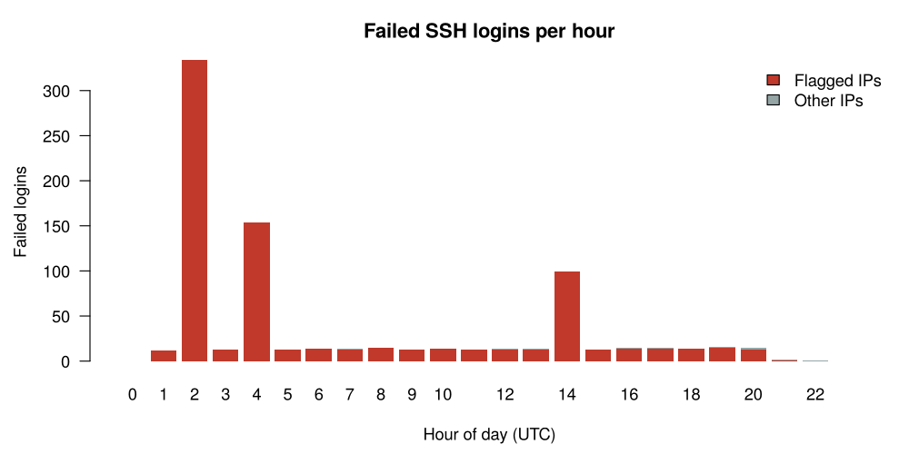

# SSH Brute-Force Detection (R)

Detecting SSH brute-force attacks in Linux authentication logs with rule-based log analysis in R.

The script parses an OpenSSH `auth.log`, builds a behavioral profile for every source IP, and flags four common attack patterns. It outputs a ranked list of suspicious IPs, a ready-to-review firewall block list, and two charts.



## What it detects

| Pattern | What it looks like | Rule (configurable) |
|---|---|---|
| **BURST** | Automated password guessing, many attempts per second | ≥ 20 failed logins inside any 5-minute sliding window |
| **ENUMERATION** | Attacker probes which usernames exist (`admin`, `test`, `oracle`...) | ≥ 5 distinct usernames tried from one IP |
| **LOW_AND_SLOW** | Throttled attack built to stay under burst thresholds | ≥ 50 failures spread over ≥ 3 hours with no burst |
| **COMPROMISE** | A guess that worked: success right after a failure streak | ≥ 10 consecutive failures followed by `Accepted password` |

IPs with a COMPROMISE flag are marked **CRITICAL**; any other flag is **HIGH**.

## Results on the sample log

The sample log (`data/auth_sample.log`) covers 24 hours on one server: 1,068 log lines and 888 authentication events, mixing normal employee logins with four simulated attackers.

| IP | Severity | Flags | Failures | Usernames | Peak / 5 min | Active hours |
|---|---|---|---|---|---|---|
| 203.0.113.99 | CRITICAL | BURST, COMPROMISE | 85 | 1 | 85 | 0.1 |
| 203.0.113.45 | HIGH | BURST | 320 | 1 | 172 | 0.2 |
| 192.0.2.77 | HIGH | LOW_AND_SLOW | 272 | 2 | 2 | 19.9 |
| 198.51.100.23 | HIGH | BURST, ENUMERATION | 140 | 15 | 87 | 0.1 |

All 4 attackers were detected, and none of the 4 legitimate internal IPs were flagged (users who mistyped a password once or twice were not flagged).
The low-and-slow attacker never had more than 2 failures in any 5-minute window, so a burst rule alone would have missed it. That's why the script has a separate time-spread rule.



## How it works

1. **Parse.** Regular expressions pull timestamp, result (failed/accepted), username, invalid-user marker and source IP out of each `sshd` line. Unrelated lines are ignored.
2. **Feature engineering per IP.** Total failures and successes, distinct usernames, invalid-user attempts, first/last seen, active duration, the **peak number of failures in a sliding time window** (computed with a two-pointer scan, O(n) after sorting) and the **longest failure streak before a successful login**.
3. **Rules.** Each feature is compared to a threshold, and an IP can get several flags.
4. **Outputs.** CSV reports, a block list and charts.

## Project structure

```
ssh-bruteforce-detection/
├── R/detect_bruteforce.R        # the full pipeline
├── data/auth_sample.log         # sample OpenSSH log (synthetic)
└── output/
    ├── suspicious_ips.csv       # flagged IPs only, ranked by severity
    ├── ip_summary.csv           # features for every source IP
    ├── blocklist.txt            # suggested iptables rules
    ├── attack_fingerprint.png
    └── failed_logins_per_hour.png
```

## Run it

You only need base R. No packages to install.

```bash
Rscript R/detect_bruteforce.R                      # runs on the sample log
Rscript R/detect_bruteforce.R /var/log/auth.log    # runs on a real server log
```

You can tune the thresholds at the top of the script (`WINDOW_MIN`, `BURST_THRESHOLD`, `ENUM_USERS`...).

## Notes and limitations

- The sample data is **synthetic** and was made for this project. Attacker addresses use the RFC 5737 documentation ranges (`192.0.2.0/24`, `198.51.100.0/24`, `203.0.113.0/24`), which are reserved for examples and do not belong to anyone.
- Syslog timestamps have no year, so the year is set by a parameter.
- Rule-based detection is transparent and easy to explain, but a distributed attack (many IPs, few attempts each) would need aggregation by subnet or by targeted username. That is a natural next step.
- Review the block list before you apply it. It is a suggestion, not an automatic action.

## Skills demonstrated

Log parsing with regular expressions · feature engineering · sliding-window time-series analysis · rule-based anomaly detection · data visualization in base R · security analysis (MITRE ATT&CK T1110: Brute Force)

---
**Rotem Rave**, Industrial Engineering & Management student, Ben-Gurion University · [LinkedIn](https://www.linkedin.com/in/rotem-rave-906b4024b)
